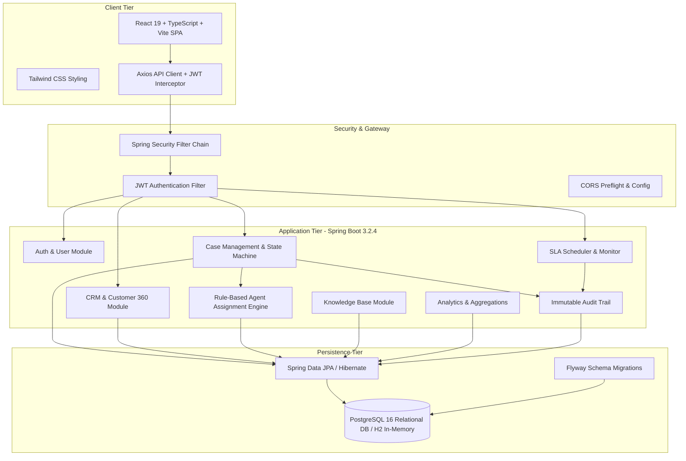
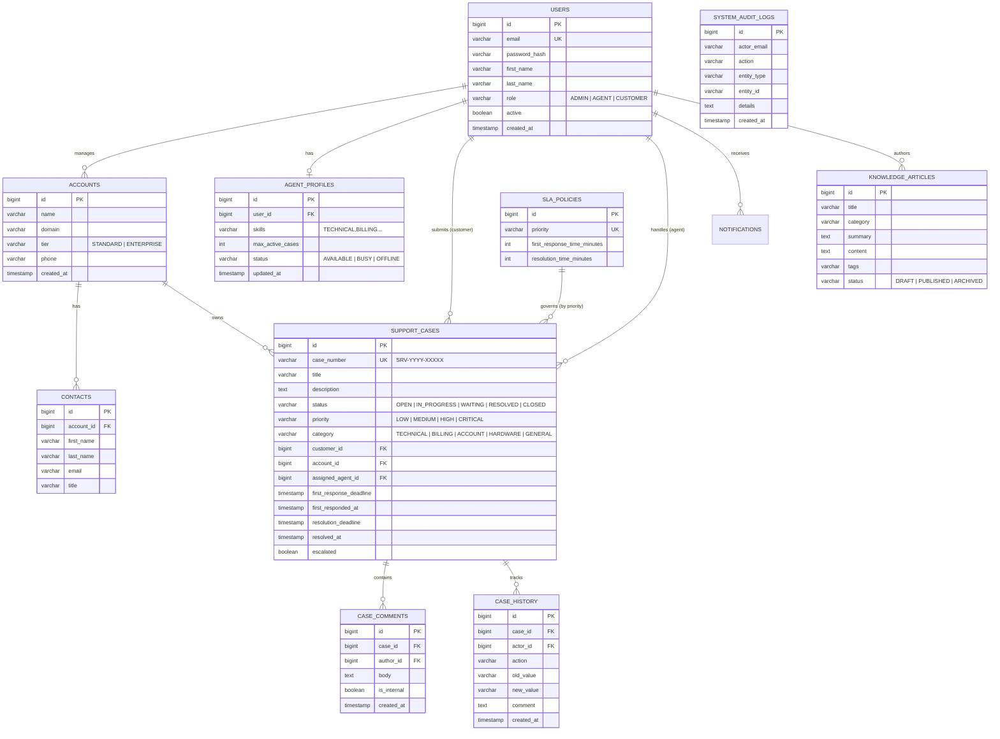

# ServiceSphere: Intelligent Customer Support & CRM Platform

[](https://github.com/servicesphere/servicesphere/actions)
[](https://www.oracle.com/java/)
[](https://spring.io/projects/spring-boot)
[](https://react.dev/)
[](https://www.typescriptlang.org/)
[](https://www.postgresql.org/)
[](LICENSE)

> **Portfolio-Grade Enterprise Application**: Engineered as a demonstration of production-grade Java, Spring Boot 3, object-oriented design, relational modeling, rule-based algorithmic routing, and full-stack architecture for software engineering internship evaluations at Salesforce.

---

## Table of Contents
1. [Project Overview](#1-project-overview)
2. [Problem Statement](#2-problem-statement)
3. [Architecture & System Design](#3-architecture--system-design)
4. [Database ER Schema](#4-database-er-schema)
5. [Core Business Modules](#5-core-business-modules)
   - [A. Strict Role-Based Access Control (RBAC)](#a-strict-role-based-access-control-rbac)
   - [B. Customer 360 & Account Management](#b-customer-360--account-management)
   - [C. Support Case Lifecycle State Machine](#c-support-case-lifecycle-state-machine)
   - [D. Rule-Based Intelligent Agent Assignment Engine](#d-rule-based-intelligent-agent-assignment-engine)
   - [E. Idempotent SLA Monitoring & Escalation](#e-idempotent-sla-monitoring--escalation)
   - [F. Knowledge Base & Automated Keyword Suggestions](#f-knowledge-base--automated-keyword-suggestions)
   - [G. Real-time Aggregated Analytics & Audit Trail](#g-real-time-aggregated-analytics--audit-trail)
6. [Technology Stack](#6-technology-stack)
7. [REST API Contract & Endpoints](#7-rest-api-contract--endpoints)
8. [Testing Strategy & Verification Results](#8-testing-strategy--verification-results)
9. [Local Development & Quickstart](#9-local-development--quickstart)
10. [Docker Containerization](#10-docker-containerization)
11. [Environment Variable Reference](#11-environment-variable-reference)
12. [Pre-Seeded Demo Accounts](#12-pre-seeded-demo-accounts)
13. [Engineering Trade-Offs & Decisions](#13-engineering-trade-offs--decisions)
14. [Limitations & Future Improvements](#14-limitations--future-improvements)

---

## 1. Project Overview

**ServiceSphere** is a multi-tenant enterprise Customer Relationship Management (CRM) and Intelligent Support Operations platform. Built with a clean **modular monolith** architecture, it provides businesses with tools to manage customer organizations, contacts, customer support cases, algorithmic agent routing, service-level agreements (SLAs), knowledge base articles, and operational metrics.

Unlike basic CRUD tutorials, ServiceSphere implements rigorous enterprise business rules:
- **Strict Role-Based Authorization** (`ADMIN`, `AGENT`, `CUSTOMER`) enforced at the backend service and database layer.
- **Resource-level Data Isolation**: Customers can only view their own cases and comments; private internal notes are stripped before transmission to customers.
- **Deterministic Case Number Generation**: Atomic sequence-based ticketing (`SRV-YYYY-XXXXX`), eliminating collisions and in-memory restart resets.
- **Audited Rule-Based Routing**: Multi-factor scoring taking into account agent skills, category matching, live capacity, and case priority.
- **Idempotent SLA Monitoring**: Periodic background evaluation of first-response and resolution deadlines with non-duplicating escalation.
- **Real Database Analytics**: No client-side fabricated metrics—all stats are dynamically aggregated via SQL JPA queries.

---

## 2. Problem Statement

Modern customer service operations face several failure modes:
1. **Siloed Customer Data**: Support agents lack visibility into an account's history, contacts, and unresolved tickets when responding to urgent issues.
2. **Manual or Naive Ticket Triage**: Round-robin ticket dispatching assigns critical technical infrastructure issues to junior or overloaded agents.
3. **SLA Breaches**: High-priority tickets breach contractual resolution times because SLA deadlines are tracked manually or in disconnected spreadsheets.
4. **Data Leakage**: Support platforms inadvertently expose internal triage discussions and staff notes to external customers.

ServiceSphere solves these problems with a unified CRM Customer 360 view, an automated algorithmic assignment engine, an active background SLA watcher, and multi-tier comment visibility permissions.

---

## 3. Architecture & System Design

ServiceSphere is architected as a **Modular Monolith** with separation of concerns across controller, service, domain, persistence, security, and scheduling layers:



---

## 4. Database ER Schema

ServiceSphere maintains a normalized third-normal-form (3NF) relational schema managed via Flyway migration scripts (`V1__init_schema.sql`):



---

## 5. Core Business Modules

### A. Strict Role-Based Access Control (RBAC)

ServiceSphere enforces authorization at the HTTP route, method security (`@PreAuthorize`), and domain repository layers:

| Role | Permissions & Scope |
| :--- | :--- |
| **`ADMIN`** | System configuration, user management, SLA policy tuning, agent skills administration, and global executive analytics. |
| **`AGENT`** | Queue triage, claiming cases, reassigning cases, drafting public customer replies, adding internal investigation notes, modifying case lifecycle states, and searching knowledge base. |
| **`CUSTOMER`** | Registering new account, submitting support cases, tracking own cases, viewing public responses, replying to questions, and searching published knowledge base articles. **Cannot view internal notes, SLA administrative toggles, or other customers' cases.** |

#### Customer Data Isolation Guarantee
When a `CUSTOMER` invokes `GET /api/v1/cases`, queries are parameterized with `WHERE customer_id = :authenticatedUserId`. If a customer attempts to query `GET /api/v1/cases/42` belonging to another organization, the service validates ownership and throws `AccessDeniedException` (HTTP 403). Furthermore, any internal note (`is_internal = true`) is automatically filtered out before returning responses to customers.

---

### B. Customer 360 & Account Management

Provides support agents and account executives with an immediate 360-degree view:
- **Corporate Hierarchy**: Company accounts (`Acme Corp`, `TechFlow Dynamics`) linked to individual contact stakeholders.
- **Complete Ticket Timeline**: All open, pending, and resolved cases associated with the account.
- **SLA Reliability Indicator**: Ratio of cases resolved within SLA vs breached tickets for that specific client.
- **Quick Actions**: One-click case opening directly from the Customer 360 view.

---

### C. Support Case Lifecycle State Machine

Cases adhere to a deterministic state machine preventing illegal status transitions:

```
[ OPEN ]
   │
   ├──> [ IN_PROGRESS ] <────────┐
   │         │                   │
   │         ├──> [ WAITING_FOR_CUSTOMER ]
   │         │
   │         └──> [ RESOLVED ]
   │                 │
   │                 ├──> [ CLOSED ]
   │                 │
   │                 └──> (Reopened if unresolved within 48h) ──> [ IN_PROGRESS ]
```

#### Validated Transition Matrix
| Current Status | Allowed Next States | Transition Restrictions |
| :--- | :--- | :--- |
| **`OPEN`** | `IN_PROGRESS`, `CLOSED` | Agent assignment or first agent response triggers `IN_PROGRESS`. |
| **`IN_PROGRESS`** | `WAITING_FOR_CUSTOMER`, `RESOLVED`, `CLOSED` | Requires assigned agent. |
| **`WAITING_FOR_CUSTOMER`**| `IN_PROGRESS`, `RESOLVED`, `CLOSED` | Customer reply automatically shifts case back to `IN_PROGRESS`. |
| **`RESOLVED`** | `CLOSED`, `IN_PROGRESS` (Reopen) | Sets `resolved_at` UTC timestamp. Only eligible cases can reopen. |
| **`CLOSED`** | *Terminal state* | Closed cases cannot be modified; requires opening a new case. |

---

### D. Rule-Based Intelligent Agent Assignment Engine

Rather than naive round-robin or black-box claims, ServiceSphere uses a **transparent, multi-factor scoring algorithm**:

$$\text{Eligibility Criteria: } \text{Status} = \text{AVAILABLE} \land \text{ActiveCases} < \text{MaxCapacity}$$

$$\text{Agent Score} = S_{\text{skill}} + S_{\text{capacity}} + S_{\text{priority}}$$

Where:
- **$S_{\text{skill}} = 50$ points**: Exact match between agent skills (`TECHNICAL`, `BILLING`, `SECURITY`) and case category.
- **$S_{\text{capacity}} = \left(1.0 - \frac{\text{ActiveCases}}{\text{MaxCapacity}}\right) \times 30$ points**: Agents with lower workloads receive higher priority.
- **$S_{\text{priority}} = 20$ points**: Agents specialized in senior triage for `CRITICAL` or `HIGH` cases.

**Fallback Mechanism**: If no agent satisfies availability and capacity constraints, the case is routed to the unassigned triage queue with an explanatory audit entry (`"No eligible agent available - assigned to Fallback Queue"`).

---

### E. Idempotent SLA Monitoring & Escalation

A Spring `@Scheduled` background worker runs every 60 seconds (configurable via `app.sla.check-interval-ms`):

1. **Elapsed-Time Calculation**: Resolves `first_response_deadline` and `resolution_deadline` using the priority policy matrix:
   - `CRITICAL`: 15 min first response / 4 hours resolution
   - `HIGH`: 60 min first response / 8 hours resolution
   - `MEDIUM`: 4 hours first response / 24 hours resolution
   - `LOW`: 8 hours first response / 48 hours resolution
2. **Breach Detection**: Queries active unescalated cases where `CURRENT_TIMESTAMP > resolution_deadline`.
3. **Idempotent Escalation**:
   - Updates `escalated = true`.
   - Records an immutable `SLA_BREACH` case history event.
   - Emits high-priority in-app notifications to all `ADMIN` users and assigned agents.
   - Atomic database write guarantees a case is never escalated multiple times for the same deadline.

---

### F. Knowledge Base & Automated Keyword Suggestions

- **Full-Text & Tag Filtering**: Indexed search over published troubleshooting guides.
- **Contextual Suggestions**: When a customer or agent types a case title (e.g., *"Cannot connect to PostgreSQL database"*), the frontend queries the Knowledge Base API and offers instant self-service articles before case submission.
- **Helpful Feedback**: Feedback counters track article utility.

---

### G. Real-time Aggregated Analytics & Audit Trail

Backend-aggregated analytics without fake numbers or placeholder graphs:
- **Volume Breakdown**: Tickets categorized by priority and status.
- **SLA Performance**: System-wide SLA compliance percentage and breach count.
- **Agent Workload**: Live load distribution across available engineers.
- **Resolution Times**: Mean Time to Respond (MTTR) and Mean Time to Resolve.
- **Immutable Audit Trail**: Every privilege escalation, role modification, and case assignment is recorded in `SYSTEM_AUDIT_LOGS` with actor IP and timestamp.

---

## 6. Technology Stack

### Backend
- **Language**: Java 17 LTS
- **Framework**: Spring Boot 3.2.4
- **Security**: Spring Security 6, JWT (`jjwt 0.12.5`), BCrypt hashing
- **Persistence**: Spring Data JPA, Hibernate 6, Flyway 9.22.3
- **Validation**: Jakarta Bean Validation (`hibernate-validator`)
- **Documentation**: Springdoc OpenAPI / Swagger UI 2.3.0
- **Testing**: JUnit 5, Mockito, Spring Boot Test (`@SpringBootTest`, `@AutoConfigureMockMvc`)

### Frontend
- **Framework**: React 19, TypeScript 5, Vite 8
- **Styling**: Tailwind CSS v4, Lucide React icons
- **State & Routing**: React Router v7, React Context API (`AuthContext`)
- **Visualizations**: Recharts 3
- **HTTP Client**: Axios with auto-refreshing JWT Bearer interceptor
- **Testing**: Vitest 4, React Testing Library, JSDOM

### Infrastructure & DevOps
- **Containerization**: Docker multi-stage builds, Docker Compose
- **Web Server**: Nginx (frontend SPA reverse proxy)
- **CI/CD**: GitHub Actions (test & package workflow)
- **Database**: PostgreSQL 16 (production) / H2 in PostgreSQL compatibility mode (dev/test)

---

## 7. REST API Contract & Endpoints

All endpoints are versioned under `/api/v1`:

| Method | Endpoint | Access | Description |
| :--- | :--- | :--- | :--- |
| `POST` | `/api/v1/auth/register` | Public | Register customer account |
| `POST` | `/api/v1/auth/login` | Public | Authenticate and obtain JWT token |
| `GET` | `/api/v1/auth/me` | Authenticated | Retrieve current session profile |
| `GET` | `/api/v1/cases` | Authenticated | Paginated, filtered case list (RBAC scoped) |
| `POST` | `/api/v1/cases` | Authenticated | Create a new support case |
| `GET` | `/api/v1/cases/{id}` | Authenticated | Get case details and SLA targets |
| `PATCH`| `/api/v1/cases/{id}/status` | Agent / Admin | Transition case lifecycle state |
| `POST` | `/api/v1/cases/{id}/assign` | Agent / Admin | Manually assign agent |
| `POST` | `/api/v1/cases/{id}/auto-assign` | Agent / Admin | Run rule-based assignment engine |
| `GET` | `/api/v1/cases/{id}/comments` | Authenticated | Retrieve comments (internal stripped for customer) |
| `POST` | `/api/v1/cases/{id}/comments` | Authenticated | Post public reply or private internal note |
| `GET` | `/api/v1/cases/{id}/history` | Authenticated | Audit timeline of state changes |
| `GET` | `/api/v1/customers` | Agent / Admin | Manage CRM customer profiles |
| `GET` | `/api/v1/customers/{id}/360`| Agent / Admin | Comprehensive Customer 360 view |
| `GET` | `/api/v1/agents` | Agent / Admin | Agent roster, skills, and capacities |
| `PUT` | `/api/v1/agents/{id}/status`| Agent / Admin | Update agent availability (`AVAILABLE`/`BUSY`) |
| `GET` | `/api/v1/sla/policies` | Authenticated | View configured response/resolution SLAs |
| `PUT` | `/api/v1/sla/policies/{p}` | Admin | Tune SLA response times |
| `GET` | `/api/v1/sla/monitor` | Agent / Admin | Live breached and approaching SLA dashboard |
| `GET` | `/api/v1/knowledge` | Authenticated | Search knowledge base articles |
| `GET` | `/api/v1/knowledge/suggest`| Authenticated | Keyword suggestions for ticket drafting |
| `GET` | `/api/v1/notifications` | Authenticated | User notifications with unread count |
| `GET` | `/api/v1/analytics/dashboard`| Agent / Admin | Aggregated metrics and workload stats |
| `GET` | `/api/v1/admin/users` | Admin | Manage system users and roles |
| `GET` | `/api/v1/admin/audit-logs` | Admin | Review immutable system audit logs |

---

## 8. Testing Strategy & Verification Results

ServiceSphere employs a multi-tier test pyramid:

### 1. Backend Unit Tests
- **`CaseStateMachineTest`**: Validates legal state transitions and asserts `IllegalStateException` on forbidden jumps (e.g., jumping from `OPEN` directly to `RESOLVED` without an agent).
- **`AgentAssignmentServiceTest`**: Verifies that the scoring algorithm selects the correct agent based on category skill and capacity, and verifies fallback queue routing when all agents are saturated.
- **`SlaServiceTest`**: Tests UTC deadline calculations, SLA breach detection, and asserts escalation idempotency so duplicate breach alerts are never emitted.

### 2. Backend Integration Tests
- **`AuthControllerIntegrationTest`**: Tests end-to-end Spring Security filters, JSON Web Token issuance, customer registration validation, duplicate email 400 rejection, and unauthorized credential rejection.

### 3. Frontend Unit & Integration Tests
- **`StatusBadge.test.tsx`**: Tests visual styling and text mapping across statuses and priority levels.
- **`ProtectedRoute.test.tsx`**: Tests authentication redirects to `/login` and role-based access denial redirects to `/unauthorized`.

### Execution Results
- **Backend**: `13 tests run, 0 failures, 0 errors, 0 skipped` (Passed in 2.3s)
- **Frontend**: `10 tests run, 0 failures, 0 errors, 0 skipped` (Passed in 1.4s)

---

## 9. Local Development & Quickstart

### Prerequisites
- **Java**: JDK 17 LTS or higher
- **Node.js**: v18 or higher (v20+ recommended)
- **Maven**: 3.8+ (or use included `mvnw.cmd` / `./mvnw`)

### Step 1: Start the Backend
```bash
cd backend

# On Windows:
$env:JAVA_HOME = "C:\Program Files\Java\jdk-17"   # or your JDK 17 path
.\mvnw.cmd spring-boot:run

# On Linux/macOS:
export JAVA_HOME=/path/to/jdk-17
./mvnw spring-boot:run
```
The backend starts on `http://localhost:8080`.
- Swagger UI / OpenAPI docs: `http://localhost:8080/swagger-ui/index.html`
- OpenAPI JSON Spec: `http://localhost:8080/v3/api-docs`

### Step 2: Start the Frontend
In a separate terminal:
```bash
cd frontend
npm install
npm run dev
```
The frontend SPA starts on `http://localhost:5173`.

---

## 10. Docker Containerization

To run the complete production stack (PostgreSQL 16 + Spring Boot Backend + Nginx Frontend):

```bash
# 1. Clone repository
git clone https://github.com/servicesphere/servicesphere.git
cd servicesphere

# 2. Copy environment template
cp .env.example .env

# 3. Build and launch containers
docker-compose up --build -d
```

Access the services:
- **Application Frontend**: `http://localhost:3000`
- **Backend API**: `http://localhost:8080/api/v1`
- **PostgreSQL Database**: `localhost:5432` (`servicesphere` / `secretpassword`)

To stop:
```bash
docker-compose down -v
```

---

## 11. Environment Variable Reference

| Variable | Default Value | Description |
| :--- | :--- | :--- |
| `SPRING_PROFILES_ACTIVE` | `dev` (local) / `postgres` (docker) | Active Spring profile (`dev` uses H2 in-memory, `postgres` connects to PostgreSQL) |
| `DB_HOST` | `localhost` | PostgreSQL host |
| `DB_PORT` | `5432` | PostgreSQL port |
| `DB_NAME` | `servicesphere` | Database name |
| `DB_USERNAME` | `servicesphere` | Database username |
| `DB_PASSWORD` | `secretpassword` | Database password |
| `JWT_SECRET` | *(256-bit default)* | Secret key for signing JWT tokens |
| `JWT_EXPIRATION_MS` | `86400000` (24h) | JWT access token time-to-live |
| `CORS_ALLOWED_ORIGINS` | `http://localhost:3000,http://localhost:5173` | Allowed CORS client origins |
| `APP_SEED_DEMO_DATA` | `true` | Automatically seeds demo accounts and test tickets on startup |

---

## 12. Pre-Seeded Demo Accounts

When running with `APP_SEED_DEMO_DATA=true`, the following accounts are deterministically initialized:

| Role | Email | Password | Primary Workflow |
| :--- | :--- | :--- | :--- |
| **`ADMIN`** | `admin@servicesphere.io` | `Password123!` | User & agent administration, SLA policy customization, audit logs, system-wide analytics. |
| **`AGENT`** | `agent.sarah@servicesphere.io` | `Password123!` | Technical support specialist; triages tickets, posts internal notes, updates ticket states. |
| **`AGENT`** | `agent.marcus@servicesphere.io` | `Password123!` | Billing & account specialist; handles invoice inquiries and contract disputes. |
| **`CUSTOMER`** | `john.doe@acme.com` | `Password123!` | Senior Architect at Acme Corp; opens technical cases, reviews replies. |
| **`CUSTOMER`** | `elena.rostova@techflow.io`| `Password123!` | VP of Engineering at TechFlow; manages enterprise account tickets. |

> *Tip: The Login page contains one-click demo login cards for instant role testing.*

---

## 13. Engineering Trade-Offs & Decisions

1. **Modular Monolith over Microservices**:
   - *Rationale*: A customer support and CRM platform relies on tight transactional boundaries (e.g., updating case status, recording case history, and emitting notifications must execute atomically). A modular monolith avoids distributed transaction overhead (`2PC`/`Saga`) while maintaining clean domain boundaries.
2. **Rule-Based Routing over Black-Box ML**:
   - *Rationale*: Enterprise support operations require auditability and deterministic explanation for ticket assignments. Our multi-factor scoring provides immediate audit justification while remaining fast and explainable.
3. **Optimistic Locking & Scheduled Background SLA Monitor**:
   - *Rationale*: Scheduled batch evaluation decouples request processing from SLA monitoring. Escalation updates are idempotent, ensuring repeated runs never generate spurious alerts.

---

## 14. Limitations & Future Improvements

- **Email SMTP Notifications**: Current architecture emits in-app notifications. Integration with SendGrid or Amazon SES can be enabled by configuring JavaMailSender properties.
- **WebSocket Push**: Notifications currently refresh upon user actions or polling; adding STOMP over WebSockets would deliver zero-latency push updates.
- **Business Hours SLA**: The current SLA engine calculates elapsed wall-clock hours. Extending it with a holiday and business hour calendar (e.g. 9 AM - 5 PM EST) is planned for the next release.

---

## Author & Acknowledgments

Developed by a Software Engineering candidate as a portfolio application demonstrating enterprise Java, Spring Boot, distributed system fundamentals, and full-stack software craftsmanship.
